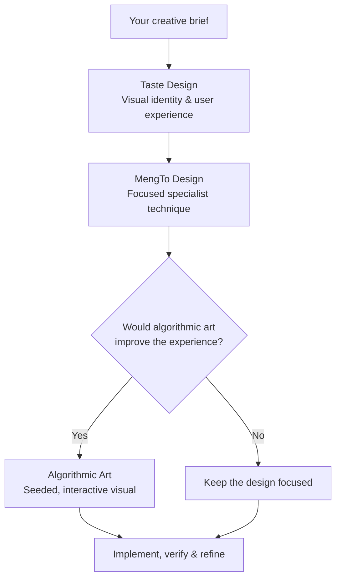

# Mad Mallard Creative Studio

**One skill. Three complementary creative disciplines.** Combine intentional website design, specialist UX workflows, and original generative art without forcing every technique into every project.

[**Open the private Creative Studio plugin in ChatGPT**](https://chatgpt.com/plugins/plugins_6b047a1755a48191a398368b1fa731d0) · [Skill instructions](SKILL.md) · [Specialist routing](references/routes.md) · [Evaluation cases](evals.json)

## How the three skills work together

| Design discipline | What it contributes | When to use it |
| :--- | :--- | :--- |
| 🎨 **Taste Design** | Establishes the visual identity, typography, layouts, responsive design, and overall quality. Makes a site feel thoughtfully designed for its actual business. | Foundation for websites, landing pages, SaaS products, and interface redesigns. |
| 🧩 **MengTo Design** | Supplies specialized workflows for landing pages, interfaces, animations, 3D experiences, and design verification. | Select a focused specialist workflow for a task needing deeper implementation guidance. |
| ✨ **Algorithmic Art** | Adds original procedural visuals, reproducible seeded artwork, and interactive creative elements. | Use when generative art serves the product or creative brief—not as decoration on every site. |

**The result:** Taste sets the direction, MengTo contributes only the needed specialist techniques, and Algorithmic Art supplies generative visuals when they meaningfully improve the experience. Accessibility, responsive behavior, and performance apply throughout.

## Example workflows

**SMB service website:** Taste establishes a credible page hierarchy, real imagery, and a clear quote request. MengTo's landing-page guidance helps make that workflow effective. Generative art is typically unnecessary.

**SaaS product site:** Taste establishes the visual system and polished interface. MengTo contributes pricing or animation guidance. Algorithmic Art can create a distinctive seeded hero if it is helpful and performant.

**Interactive art gallery:** Algorithmic Art defines the seeded visuals and meaningful controls. Taste establishes gallery layout, typography, and interaction quality. MengTo can contribute precise motion and UI techniques.

## Use in ChatGPT

> Use Mad Mallard Creative Studio to redesign my SaaS homepage with a strong visual hierarchy, an accessible responsive layout, and an original seeded generative hero—only if it supports the product story.

The private plugin is version **0.1.0**. The three standalone skills remain available independently. This skill provides orchestration instructions, **not** a bundled browser, a local Node/Chromium runtime, or automatic deployment. Only claim tests, rendered assets, and deployments that actually ran.

## Sources and licensing

- [Taste Skill](https://github.com/Leonxlnx/taste-skill) — MIT
- [MengTo Skills](https://github.com/mengto/skills) — MIT
- [Algorithmic Art](https://github.com/anthropics/skills/tree/main/skills/algorithmic-art) — Apache-2.0

This is an original ChatGPT adaptation. For implementation limits and provenance, see [ADAPTER.md](ADAPTER.md).
