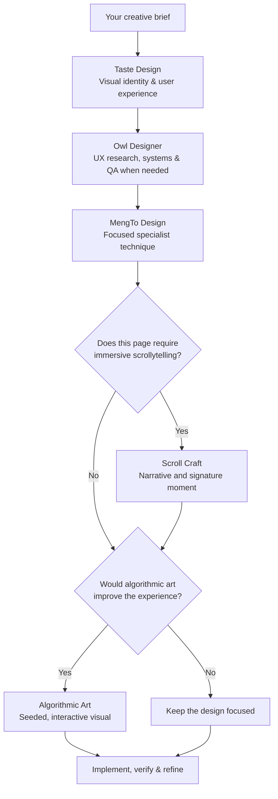

# Mad Mallard Creative Studio

**One skill. Five complementary creative disciplines.** Combine intentional website design, specialist UX workflows, and original generative art without forcing every technique into every project.

[**Open the private Creative Studio plugin in ChatGPT**](https://chatgpt.com/plugins/plugins_6b047a1755a48191a398368b1fa731d0) · [Skill instructions](SKILL.md) · [Specialist routing](references/routes.md) · [Evaluation cases](evals.json)

## How the five skills work together

| Design discipline | What it contributes | When to use it |
| :--- | :--- | :--- |
| 🎨 **Taste Design** | Establishes the visual identity, typography, layouts, responsive design, and overall quality. Makes a site feel thoughtfully designed for its actual business. | Foundation for websites, landing pages, SaaS products, and interface redesigns. |
| 🧩 **MengTo Design** | Supplies specialized workflows for landing pages, interfaces, animations, 3D experiences, and design verification. | Select a focused specialist workflow for a task needing deeper implementation guidance. |
| 🌊 **Scroll Craft** | Defines experiential scroll storytelling: page grammar, feeling curve, dimensional hero, signature interaction, memorable peak, and visual scroll verification. | Only for immersive public-facing stories and premium marketing pages. Not dashboards, checkout, or ordinary forms. |
| 🦉 **Owl Designer** | Adds research, accessible forms, UX strategy, reusable system rules, design critique, usability evaluation and engineering handoff. | Use at specific research, flow, accessibility or QA stages—not as a substitute for Taste branding or MengTo implementation. |
| ✨ **Algorithmic Art** | Adds original procedural visuals, reproducible seeded artwork, and interactive creative elements. | Use when generative art serves the product or creative brief—not as decoration on every site. |

**The result:** Taste sets visual direction; Scroll Craft is an opt-in narrative specialist; Owl-Listener supplies focused UX research, design-system, accessibility and QA workflows; MengTo handles specialized implementation; Algorithmic Art is optional. Competing guidance is resolved in favor of real user requirements, accessibility, existing brand contracts, verified behavior and then task specialization. Accessibility, responsive behavior, and performance apply throughout.

## Open-source design references (Mobbin alternatives)

For targeted inspiration, Creative Studio can consult these **four complementary research sources** before designing:

| Reference source | Best use | Type |
| --- | --- | --- |
| [Awwwards MCP](../awwwards/ADAPTER.md) | Creative marketing sites, memorable 404s and motion references | MCP |
| [Screenshots Design Inspiration](../screenshots/ADAPTER.md) | Actual product screenshots, UI states and flows | MCP |
| [Design Scope](../design-scope/ADAPTER.md) | Palette, typography and interaction pattern references | Python MCP |
| [Flowscope](../flowscope/ADAPTER.md) | Browse original screens and user flows | Static/local gallery |

They are **optional reference tools**, not replacements for Taste, Owl, MengTo, Scroll Craft or Algorithmic Art. Use [source selection and rights guidance](references/design-inspiration.md). The [cross-platform installer](../../scripts/install_design_toolkit.py) and [GitHub Actions](../../actions/setup-design-toolkit/action.yml) are in this same repository; a ChatGPT skill does not silently connect those local services.

## Example workflows

**SMB service website:** Taste establishes a credible page hierarchy, real imagery, and a clear quote request. MengTo's landing-page guidance helps make that workflow effective. Generative art is typically unnecessary.

**SaaS product site:** Taste establishes the visual system and polished interface. MengTo contributes pricing or animation guidance. Algorithmic Art can create a distinctive seeded hero if it is helpful and performant.

**Interactive art gallery:** Algorithmic Art defines the seeded visuals and meaningful controls. Taste establishes gallery layout, typography, and interaction quality. MengTo can contribute precise motion and UI techniques.

## Brand identity and first-class image generation

Creative Studio establishes an **individual brand identity for each unrelated product**, using audience, business purpose, personality and existing approved identity. If a new product has no approved logo and an image-generation capability is available, it **generates three visually different original logo concepts** (not three recolors), presents a meaningful direction choice, and records the approved identity. Original images, illustrations and backgrounds are generated when useful, with optimized favicons and reusable assets maintained in the product repository. Taste owns visual personality; Owl verifies accessible color, readable type and keyboard UX; MengTo implements; Algorithmic Art supplies optional procedural imagery; Scroll Craft handles immersive storytelling. **Anti-repetition:** never automatically reuse palettes, generic marks, typography pairings or dashboard/landing templates across unrelated products. Preserve established brand choices in subsequent development. See [Brand Identity guidance](references/brand-identity.md).

## Design Discovery (before substantial new builds)

Creative Studio now performs **adaptive discovery** before a new site or material redesign when the brief is missing a consequential decision. It considers purpose, audience, style, inspiration, branding, features/conversion, technology and priorities; **these are candidate topics, not eight mandatory questions**. Ask one to three relevant conversational questions only when necessary, reuse known project decisions, and allow **"Use your judgment"** or **"Surprise me"** for optional aesthetics. If the user supplies a complete brief, requests a small repair, or delegates the creative choices, proceed without interrogation. Once the brief is sufficient, build and test without repetitive approval requests. [Full behavior and examples](references/design-discovery.md).

## Use in ChatGPT

> Use Mad Mallard Creative Studio to redesign my SaaS homepage with a strong visual hierarchy, an accessible responsive layout, and an original seeded generative hero—only if it supports the product story.

The private ChatGPT plugin is being updated to **version 0.5.0**, incorporating Scroll Craft and the four optional Mobbin-alternative research routes. The five standalone skills remain available independently. This skill provides orchestration instructions, **not** a bundled browser, a local Node/Chromium runtime, or automatic deployment. Only claim tests, rendered assets, and deployments that actually ran.

## Scroll Craft fit and limits

This integration enhances the existing studio rather than replacing Taste, MengTo, Owl or Algorithmic Art. It specializes in multi-scene experiential scroll storytelling and uses the single upstream engine when an actual narrative runtime is selected. Generic hover/scroll reveals stay with MengTo; form and task flows stay with Owl. See [integration assessment](../scroll-craft/ASSESSMENT.md) and [routing table](references/routes.md).

## Sources and licensing

- [Taste Skill](https://github.com/Leonxlnx/taste-skill) — MIT
- [MengTo Skills](https://github.com/mengto/skills) — MIT
- [Owl-Listener Designer Skills](https://github.com/Owl-Listener/designer-skills) — MIT, © 2026 MC Dean
- [Scroll Craft](https://github.com/nateherkai/scroll-craft) — MIT
- [Algorithmic Art](https://github.com/anthropics/skills/tree/main/skills/algorithmic-art) — Apache-2.0

This is an original ChatGPT adaptation. For implementation limits and provenance, see [ADAPTER.md](ADAPTER.md).
